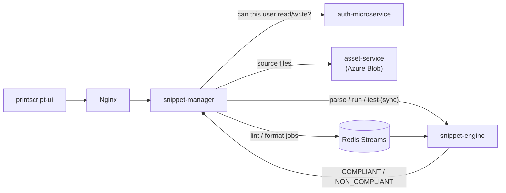

# snippet-manager

The core backend of the [Snippet Searcher platform](https://github.com/JVM-austral): a web app where users write, share,
lint, format, test and run code snippets in **PrintScript**, a small language with its own
[interpreter](https://github.com/JVM-austral/tp-ingsis-interpreter).

This service owns snippet metadata and is the frontend's only entry point. It coordinates the other services:
[auth](https://github.com/JVM-austral/auth-microservice) for permissions,
[engine](https://github.com/JVM-austral/snippet-engine) for running code, and the asset service for storing source
files.

## How it fits together



**Async rule changes.** When a user changes their lint or format rules, every one of their snippets has to be
re-checked. Instead of doing that inside the request, the manager marks the snippets as `PENDING` and publishes one
event per snippet to a Redis Stream. The engine consumes them in a consumer group and reports each result back, so
the UI shows compliance updating snippet by snippet while the request returns right away.

## API

| Area | Endpoints |
| --- | --- |
| Snippets | `POST/PATCH /snippets`, `GET /snippets`, `GET/DELETE /snippets/{id}`, `POST /snippets/share`, `POST /snippets/run`, `GET /snippets/languages` |
| Rules | `POST /config/save-linting`, `POST /config/save-formatting`, `GET /config/linting`, `GET /config/format`, `POST /config/format-unique` |
| Test cases | `POST /testing/save`, `POST /testing/run`, `PUT /testing/edit`, `DELETE /testing`, `GET /testing/{snippetId}` |
| Internal | `PUT /snippets/compiling-state` (called by the engine) |

All endpoints require an Auth0 Bearer token. Each request checks the user's permission on the snippet against the
auth service before acting.

## Stack

Kotlin · Spring Boot 3 · Spring Data JPA · PostgreSQL · Redis Streams · Auth0 · Docker · Nginx

## Quality

- Unit and integration tests. The build fails below **80 % coverage** (JaCoCo) or on any **ktlint** violation.
- CI/CD on GitHub Actions: build and test, push the image to GHCR, deploy to the dev or prod VM over SSH.

## Run the whole platform locally

This repo's `docker-compose.yml` starts every service: manager, engine, auth, asset service, one Postgres per
service, Redis, Azurite (local Azure Blob emulator) and Nginx as the reverse proxy on port 8080.

```bash
cp .env-example .env    # database and Auth0 settings
docker compose up --build
```

Tests:

```bash
./gradlew check
```
